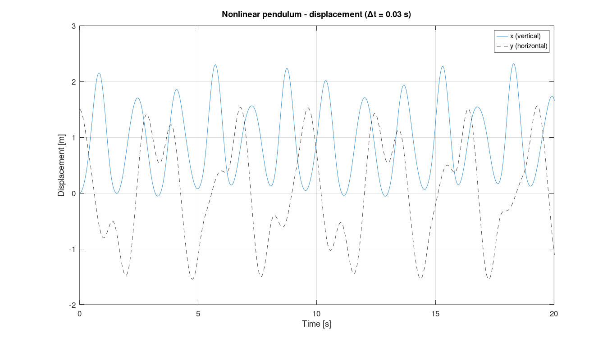
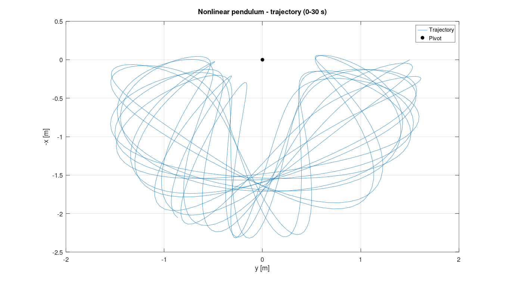
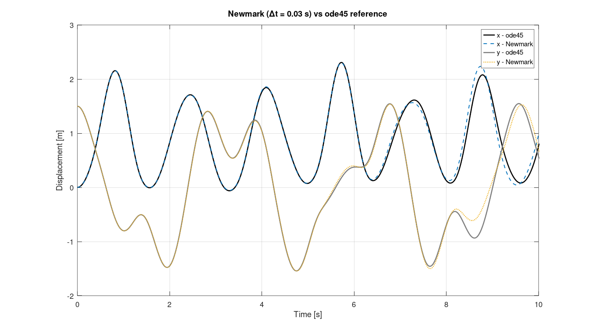
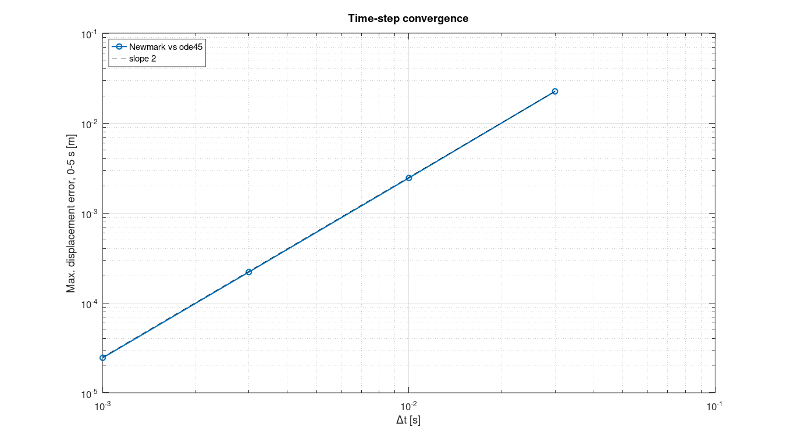

# Nonlinear Newmark Method — MATLAB Implementation

> **MSc Dissertation Project** · UNICAMP · 2025

## Overview

MATLAB implementation of the **nonlinear Newmark time integration method** for structural dynamic systems with nonlinear internal forces. Developed and validated as part of the MSc dissertation *"Nonlinear Modeling of Clunk Noise in Vehicle Transmission Systems"* (UNICAMP, 2025).

The solver handles equations of motion of the form:

$$M\ddot{u} + C\dot{u} + Ku + K_{nl}u^3 = F(t)$$

where $K_{nl}u^3$ represents a cubic nonlinear stiffness term (e.g., gear backlash / impact pair).

---

## Method Description

The **predictor-corrector** scheme uses Newmark integration constants $\gamma$ and $\beta$:

|        Scheme        |$\gamma$|$\beta$|        Stability       |
|----------------------|--------|-------|------------------------|
| Average acceleration |   0.5  |  0.25 | Unconditionally stable |
| Linear acceleration  |   0.5  |  1/6  | Conditionally stable   |

At each time step, the predicted state is corrected via **Newton-Raphson** iterations using the tangent stiffness matrix:

$$K_t = \frac{\partial P}{\partial u} = K + 3K_{nl}u^2$$

Convergence is checked against the residual:

$$\Psi = M\ddot{u} + C\dot{u} + Ku + K_{nl}u^3 - F(t)$$

The effective system solved at each iteration is:

$$\underbrace{\left(K_t + \frac{\gamma}{\beta \Delta t}C + \frac{1}{\beta \Delta t^2}M\right)}_{S} \delta u = -\Psi$$

---

## File Structure

```
01_nonlinear-newmark-method/
│
├── core/
│   ├── newmark_nonlinear.m     ← Main solver (predictor-corrector + NR)
│   ├── newmark_linear.m        ← Linear reference solver (no iterations)
│   └── runge_kutta.m           ← RK4 independent validation
│
├── models/
│   ├── system_parameters.m     ← System properties (M, K, C, dt, Np, …)
│   ├── force_vector.m          ← Excitation generator (impulse, step, harmonic...)
│   └── state_space_model.m     ← lsim() reference (MATLAB Control Toolbox)
│
├── examples/
│   └── main_impact_pair.m      ← Self-contained runnable example
│
└── validation/
    ├── validate_amesim.m       ← Reproducible comparison against Simcenter AMESim
    ├── validate_spring_pendulum.m ← Elastic pendulum (Géradin & Rixen, 2014) + ode45 reference
    └── data/
        └── amesim_harmonic_0p2Hz.csv  ← AMESim reference (4 cases, 10 ms samples)
```

---

## Quick Start

```matlab
% Run the self-contained example
cd examples
run main_impact_pair.m
```

The example compares three solvers for three nonlinear stiffness values ($K_{nl}$ = 0, 1, 10 N/m³).

---

## API Reference

### `newmark_nonlinear`

```matlab
[u, up, upp] = newmark_nonlinear(M, K, Knl, C, F, u0, u0p, dt, Np, gamma, beta, tol)
```

| Parameter | Description | Size |
|-----------|-------------|------|
| `M` | Mass matrix | Ne × Ne |
| `K` | Linear stiffness matrix | Ne × Ne |
| `Knl` | Cubic stiffness coefficient | scalar |
| `C` | Damping matrix | Ne × Ne |
| `F` | Force matrix | Ne × Np |
| `u0`, `u0p` | Initial displacement, velocity | Ne × 1 |
| `dt` | Time step [s] | scalar |
| `Np` | Number of steps | integer |
| `gamma`, `beta` | Newmark parameters | scalar |
| `tol` | Newton-Raphson tolerance | scalar |
| **`u`** | Displacement history | Ne × Np |
| **`up`** | Velocity history | Ne × Np |
| **`upp`** | Acceleration history | Ne × Np |

---

## Validation Results

### Reproducible benchmark (included in this repository)

`validation/validate_amesim.m` compares the solver with the same SDOF system modelled in **Simcenter AMESim** (mass + damper + cubic spring), $m = 20$ kg, $k = 20$ N/m, $c = 4$ N·s/m, under a harmonic force $F_0 \sin(2\pi \cdot 0.2\, t)$, $\Delta t = 1$ ms, 20 s:

| $K_{nl}$ [N/m³] | $F_0$ [N] | Peak error | RMS error |
|---|---|---|---|
| 0 (linear) | 10 | 0.0001 % | 0.0001 % |
| 10 | 10 | 0.0003 % | 0.0003 % |
| 100 | 100 | 0.0002 % | 0.0002 % |
| 500 | 1000 | 0.034 % | 0.016 % |

Errors are normalized by the AMESim response. The same agreement (≤ 0.06 %) holds for all 17 load/stiffness combinations exported during the dissertation; four representative cases are shipped to keep the repository small.


*Left: AMESim (black) and nonlinear Newmark (dashed blue) displacement. Right: difference $x_{NM} - x_{AS}$.*

**What the comparison shows**

- **The curves overlap in every case**, from the linear response ($K_{nl} = 0$) to the strongly nonlinear one ($K_{nl} = 500$ N/m³, $F_0 = 1000$ N), where the cubic spring adds several superharmonic oscillations per load cycle. The solver captures that waveform, not only the amplitude.
- **In the first three cases the difference is about $10^{-6}$ m**, roughly six orders of magnitude below the response. At that level the difference reflects the two codes' different integrators and output sampling, not a modelling discrepancy.
- **In the strongly nonlinear case the error grows with time** (up to $6 \times 10^{-4}$ m at $t \approx 19$ s) and oscillates at the response frequency. This is a small accumulated *phase* error, typical of any time integrator on a hardening system: the stiffer the response, the higher its frequency content relative to $\Delta t$. The peak error is still only 0.034 %.
- **Peak error** is the largest difference relative to the largest AMESim displacement. **RMS error** is the RMS of the difference relative to the RMS of the AMESim response. Both being of the same order shows that there is no isolated spike: the agreement is uniform along the whole record.

```matlab
cd validation
validate_amesim
```

### Geometrically nonlinear benchmark — elastic pendulum (Géradin & Rixen, 2014)

The cubic-spring cases above have a nonlinearity on the diagonal only. To check the Newton-Raphson corrector with a **fully coupled tangent stiffness**, the dissertation appendix reproduces the elastic (spring) pendulum example from Géradin & Rixen (2014, Ch. 7). `validation/validate_spring_pendulum.m` is the dissertation script (same predictor-corrector loop, written for this 2-DOF problem) extended with an `ode45` reference solution.

A mass $m$ hangs from a pivot on a spring of stiffness $k$ and unstretched length $\ell_0$; $x$ is vertical (downwards) and $y$ horizontal:

$$m\ddot{x} + k(\ell-\ell_0)\frac{x}{\ell} - mg = 0, \qquad m\ddot{y} + k(\ell-\ell_0)\frac{y}{\ell} = 0, \qquad \ell = \sqrt{x^2+y^2}$$

$$K_t = k\left[\left(1-\frac{\ell_0}{\ell}\right)I + \frac{\ell_0}{\ell^3}\,\mathbf{q}\mathbf{q}^T\right], \qquad \mathbf{q} = [x\;\; y]^T$$

| Parameter | Value |
|---|---|
| $m$, $k$, $g$, $\ell_0$ | 1 kg, 30 N/m, 10 m/s², 1 m |
| Initial conditions | $x(0) = 0$, $y(0) = 1.5$ m, $\dot{x}(0) = \dot{y}(0) = 0$ |
| Newmark | $\gamma = 1/2$, $\beta = 1/4$, $h = 0.03$ s, 30 s |
| Convergence | $\lVert r \rVert < mg \cdot 10^{-5}$ |


*Displacements with the book settings ($h = 0.03$ s), shown over 0–20 s as in the book.*


*Trajectory of the mass over 0–30 s (pivot at the origin), the time span that reproduces the book's trajectory figure.*

**Comparison with the book.** The displacement and velocity histories match, visually, the figures published by Géradin & Rixen for the same data, curve by curve over 0–20 s. The book does not state the time span of its trajectory plot; with 30 s the trajectory reproduces it, including the end point and the narrow loops near the pivot. (The book gives plots only, no numerical values, and its figures are not reproduced here for copyright reasons.)

**Quantitative check.** Since the book has no numbers to compare against, the script also compares the solution with a high-accuracy reference (`ode45`, RelTol 1e-10) and repeats it with smaller steps:


*Newmark with the book step ($h = 0.03$ s) vs. the `ode45` reference: the curves overlap for the first ~6 s, then a small phase lag builds up.*

| $\Delta t$ [s] | Max. error, 0–5 s [m] | Error > 0.1 m after | Max. energy drift | Newton it./step |
|---|---|---|---|---|
| 0.030 (book) | 2.3 × 10⁻² | 8.2 s | 1.17 % | 3.7 |
| 0.010 | 2.5 × 10⁻³ | 13.0 s | 0.13 % | 3.0 |
| 0.003 | 2.2 × 10⁻⁴ | 19.8 s | 0.012 % | 3.0 |
| 0.001 | 2.5 × 10⁻⁵ | 20.9 s | 0.001 % | 2.2 |


*Error vs. time step: observed order 2.01, the theoretical order of the trapezoidal rule.*

- **Second-order convergence.** Each 3× reduction of $\Delta t$ divides the error by about 9 (observed order 2.01).
- **Conservative scheme.** With $\gamma = 1/2$ there is no numerical damping: total energy stays within 1.2 % over 30 s at the book's step and within 0.001 % at $\Delta t = 1$ ms.
- **Fast Newton convergence.** 2–4 iterations per step to reach $\lVert r \rVert < mg \cdot 10^{-5}$.
- **Long-time divergence is physical, not numerical.** The swing–stretch coupling makes the motion very sensitive to small phase errors, so any two solutions (even two reference solvers) drift apart after some seconds. A smaller $\Delta t$ only delays that point (8 s → 13 s → 20 s → 21 s).

```matlab
cd validation
validate_spring_pendulum
```

### Dissertation results — impact pair model

For the Impact Pair gear model with three backlash configurations (dissertation, data not included):

| Time step $\Delta t$ | Mean error — Displacement | Mean error — Acceleration |
|----------|----------|--------|
| 0.01 s   | 10.6%    | 282%   |
| 0.001 s  | 0.107%   | 1.51%  |
| 0.0001 s | 0.00126% | 0.022% |

> ✅ For engineering applications, $\Delta t = 0.001$ s provides excellent accuracy.

---

## Dependencies

- MATLAB R2019b or later (no additional toolboxes required for core solvers)
- Control System Toolbox (optional — only for `state_space_model.m`)

---


## Results


*Step response for increasing cubic stiffness: nonlinear Newmark vs linear Newmark and RK4 — `examples/main_impact_pair.m`.*

---

## References

- **Gass, N.L.** (2025). *Nonlinear modeling of clunk noise in vehicle transmission systems*. MSc Dissertation, UNICAMP.
- Géradin, M. & Rixen, D. (2014). *Mechanical Vibrations: Theory and Application to Structural Dynamics*. 3rd ed. Wiley.
- Bathe, K.J. & Wilson, E.L. (1976). *Numerical Methods in Finite Element Analysis*. Prentice Hall.
- Comparin, R.J. & Singh, R. (1988). Nonlinear frequency response characteristics of an impact pair. *Journal of Sound and Vibration*, 134(2), 259–290.
