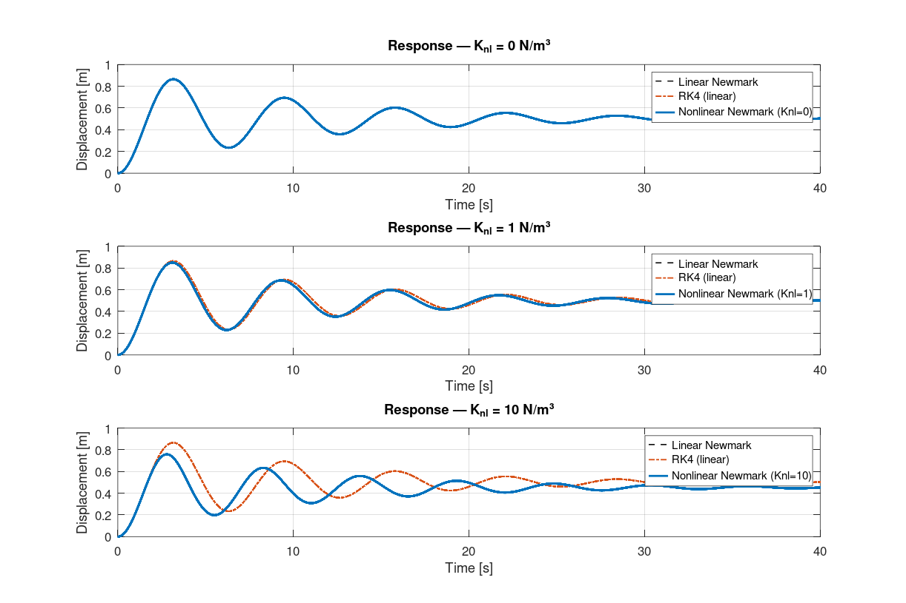

# Nonlinear Newmark Method — MATLAB Implementation

> **MSc Dissertation Project** · UNICAMP · 2025

## Overview

MATLAB implementation of the **nonlinear Newmark time integration method** for structural dynamic systems with nonlinear internal forces. Developed and validated as part of the MSc dissertation *"Nonlinear Modeling of Clunk Noise in Vehicle Transmission Systems"* (UNICAMP, 2025).

The solver handles equations of motion of the form:

$$M\ddot{u} + C\dot{u} + Ku + K_{nl}u^3 = F(t)$$

where $K_{nl}u^3$ represents a cubic nonlinear stiffness term (e.g., gear backlash / impact pair).

---

## Method Description

The **predictor-corrector** scheme uses Newmark integration constants $\gamma$ and $\beta$:

|        Scheme        |$\gamma$|$\beta$|        Stability       |
|----------------------|--------|-------|------------------------|
| Average acceleration |   0.5  |  0.25 | Unconditionally stable |
| Linear acceleration  |   0.5  |  1/6  | Conditionally stable   |

At each time step, the predicted state is corrected via **Newton-Raphson** iterations using the tangent stiffness matrix:

$$K_t = \frac{\partial P}{\partial u} = K + 3K_{nl}u^2$$

Convergence is checked against the residual:

$$\Psi = M\ddot{u} + C\dot{u} + Ku + K_{nl}u^3 - F(t)$$

The effective system solved at each iteration is:

$$\underbrace{\left(K_t + \frac{\gamma}{\beta \Delta t}C + \frac{1}{\beta \Delta t^2}M\right)}_{S} \delta u = -\Psi$$

---

## File Structure

```
01_nonlinear-newmark-method/
│
├── core/
│   ├── newmark_nonlinear.m     ← Main solver (predictor-corrector + NR)
│   ├── newmark_linear.m        ← Linear reference solver (no iterations)
│   └── runge_kutta.m           ← RK4 independent validation
│
├── models/
│   ├── system_parameters.m     ← System properties (M, K, C, dt, Np, …)
│   ├── force_vector.m          ← Excitation generator (impulse, step, harmonic...)
│   └── state_space_model.m     ← lsim() reference (MATLAB Control Toolbox)
│
├── examples/
│   └── main_impact_pair.m      ← Self-contained runnable example
│
└── validation/
    ├── validate_amesim.m       ← Reproducible comparison against Simcenter AMESim
    └── data/
        └── amesim_harmonic_0p2Hz.csv  ← AMESim reference (4 cases, 10 ms samples)
```

---

## Quick Start

```matlab
% Run the self-contained example
cd examples
run main_impact_pair.m
```

The example compares three solvers for three nonlinear stiffness values ($K_{nl}$ = 0, 1, 10 N/m³).

---

## API Reference

### `newmark_nonlinear`

```matlab
[u, up, upp] = newmark_nonlinear(M, K, Knl, C, F, u0, u0p, dt, Np, gamma, beta, tol)
```

| Parameter | Description | Size |
|-----------|-------------|------|
| `M` | Mass matrix | Ne × Ne |
| `K` | Linear stiffness matrix | Ne × Ne |
| `Knl` | Cubic stiffness coefficient | scalar |
| `C` | Damping matrix | Ne × Ne |
| `F` | Force matrix | Ne × Np |
| `u0`, `u0p` | Initial displacement, velocity | Ne × 1 |
| `dt` | Time step [s] | scalar |
| `Np` | Number of steps | integer |
| `gamma`, `beta` | Newmark parameters | scalar |
| `tol` | Newton-Raphson tolerance | scalar |
| **`u`** | Displacement history | Ne × Np |
| **`up`** | Velocity history | Ne × Np |
| **`upp`** | Acceleration history | Ne × Np |

---

## Validation Results

### Reproducible benchmark (included in this repository)

`validation/validate_amesim.m` compares the solver with the same SDOF system modelled in **Simcenter AMESim** (mass + damper + cubic spring), $m = 20$ kg, $k = 20$ N/m, $c = 4$ N·s/m, under a harmonic force $F_0 \sin(2\pi \cdot 0.2\, t)$, $\Delta t = 1$ ms, 20 s:

| $K_{nl}$ [N/m³] | $F_0$ [N] | Peak error | RMS error |
|---|---|---|---|
| 0 (linear) | 10 | 0.0001 % | 0.0001 % |
| 10 | 10 | 0.0003 % | 0.0003 % |
| 100 | 100 | 0.0002 % | 0.0002 % |
| 500 | 1000 | 0.034 % | 0.016 % |

Errors are normalized by the AMESim response. The same agreement (≤ 0.06 %) holds for all 17 load/stiffness combinations exported during the dissertation; four representative cases are shipped to keep the repository small.

```matlab
cd validation
validate_amesim
```

### Dissertation results — impact pair model

For the Impact Pair gear model with three backlash configurations (dissertation, data not included):

| Time step $\Delta t$ | Mean error — Displacement | Mean error — Acceleration |
|----------|----------|--------|
| 0.01 s   | 10.6%    | 282%   |
| 0.001 s  | 0.107%   | 1.51%  |
| 0.0001 s | 0.00126% | 0.022% |

> ✅ For engineering applications, $\Delta t = 0.001$ s provides excellent accuracy.

---

## Dependencies

- MATLAB R2019b or later (no additional toolboxes required for core solvers)
- Control System Toolbox (optional — only for `state_space_model.m`)

---


## Results


*Nonlinear Newmark (Δt = 1 ms) vs Simcenter AMESim for four stiffness/load cases — `validation/validate_amesim.m`. Peak error ≤ 0.034 %.*


*Step response for increasing cubic stiffness: nonlinear Newmark vs linear Newmark and RK4 — `examples/main_impact_pair.m`.*

---

## References

- **Gass, N.L.** (2025). *Nonlinear modeling of clunk noise in vehicle transmission systems*. MSc Dissertation, UNICAMP.
- Geradin, M. & Rixen, D. (2014). *Mechanical Vibrations: Theory and Application to Structural Dynamics*. 3rd ed. Wiley.
- Bathe, K.J. & Wilson, E.L. (1976). *Numerical Methods in Finite Element Analysis*. Prentice Hall.
- Comparin, R.J. & Singh, R. (1988). Nonlinear frequency response characteristics of an impact pair. *Journal of Sound and Vibration*, 134(2), 259–290.
