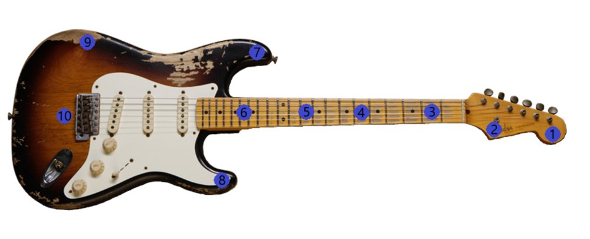
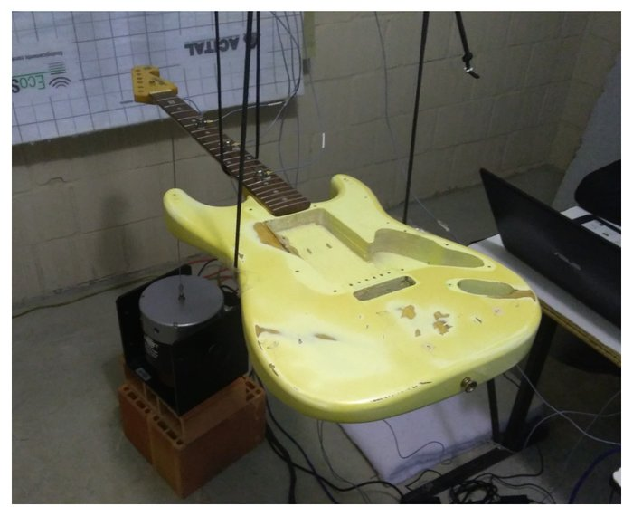
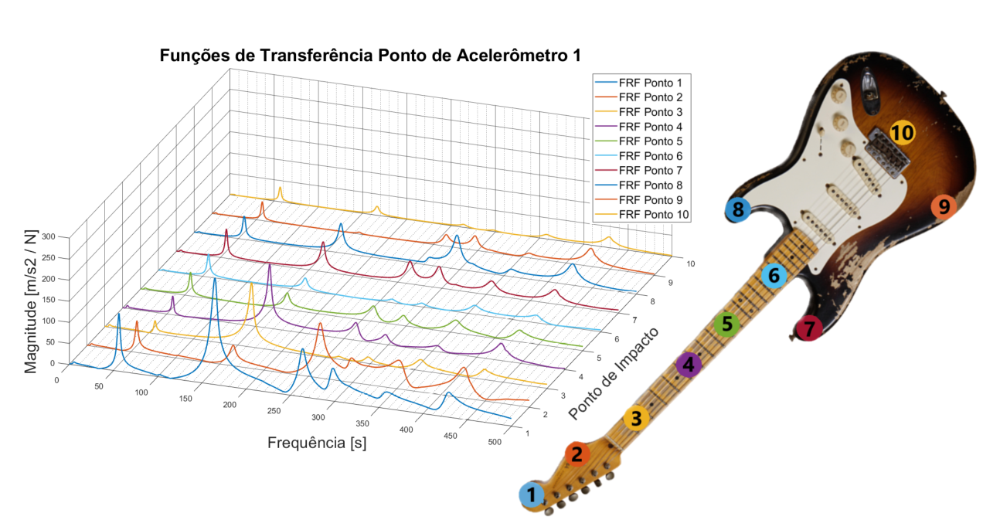
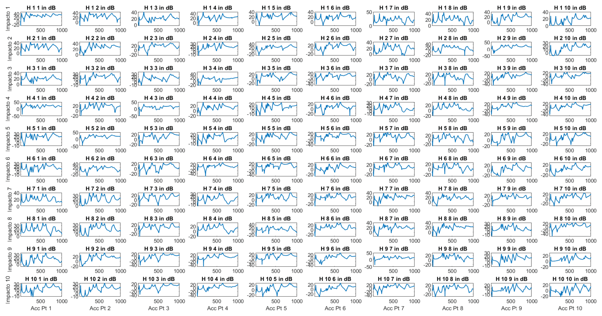
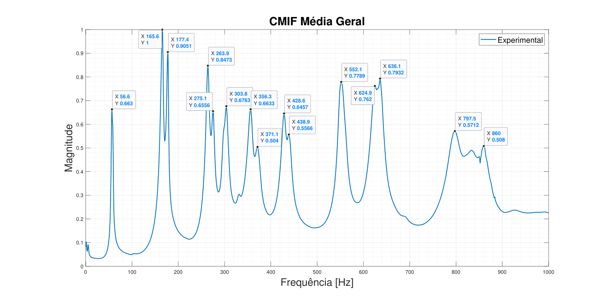
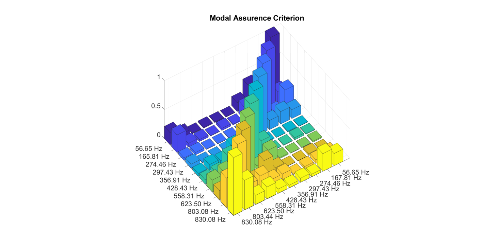
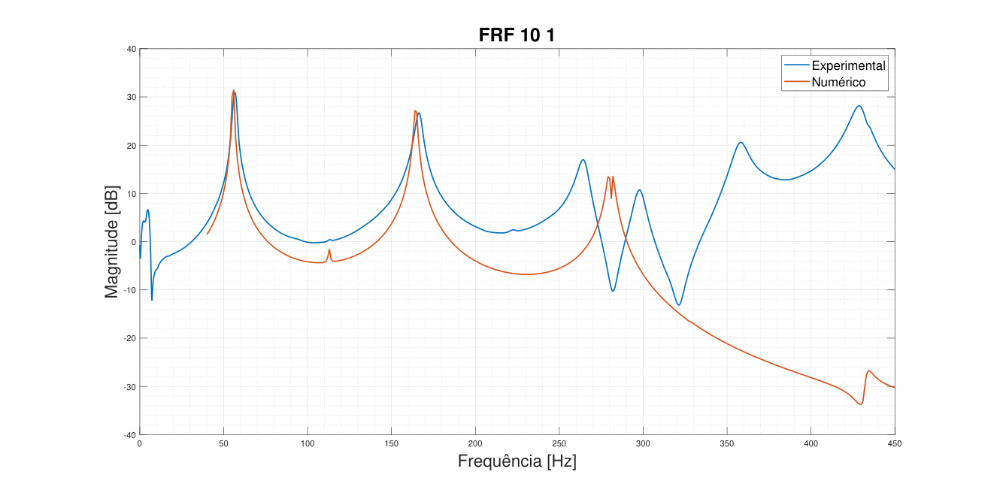

# Experimental Modal Analysis — Undergraduate Thesis (TCC)

> **Undergraduate Thesis (TCC)** · Acoustical Engineering · UFSM · 2020
>
> Gass, N. L. (2020). *Análise modal e caracterização de guitarras elétricas* (Modal analysis and characterization of electric guitars). BSc thesis, Universidade Federal de Santa Maria. Advisor: Prof. Dr. Marco Antonio Silva Pinheiro.

---

## Overview

MATLAB suite for the **experimental modal analysis of an electric guitar** (solid body + bolt-on neck) with impact hammer and electrodynamic shaker excitation, developed for my undergraduate thesis at UFSM. Ten measurement points on body and neck give a 10 × 10 FRF matrix, processed with CMIF, modal parameter extraction and MAC, and compared with a finite element model of the instrument (FEM model not included here).

### Signal Chain

```
NI cDAQ-9234 (IEPE) → DAQ Toolbox → H1 FRF Estimator → CMIF → modalsd()
    → Mode shape extraction → MAC matrix → 3D animation
```

---

## Hardware

|      Equipment      |            Specification            |
|---------------------|-------------------------------------|
| Data acquisition    | NI cDAQ-9178 chassis + NI-9234 module (4 ch, 24-bit, IEPE) |
| Accelerometers      | 3× Brüel & Kjær Type 4513B           |
| Excitation (impact) | Brüel & Kjær Type 8206 impact hammer |
| Excitation (shaker) | Electrodynamic shaker + white noise |
| Sampling rate       | 5120 Hz                             |
| FFT resolution      | 1 Hz (1 s windows)                  |

---

## Acquisition Parameters

|       Parameter      |                   Value                  |
|----------------------|------------------------------------------|
| Measurement points   | 10 (body and neck) → 10 × 10 FRF matrix  |
| Accelerometer groups | 3 accelerometers moved across the points |
| Averages per point   | 6 (hammer) / spectral averaging (shaker) |
| FRF estimator        | H1 (cross-spectrum / auto-spectrum)      |

---

## File Structure

```
02_modal-analysis-tcc/
│
├── acquisition/
│   ├── hammer_measurement.m       ← NI-DAQ acquisition with impact trigger
│   └── shaker_measurement.m       ← NI-DAQ acquisition with white noise input
│
├── processing/
│   ├── CMIF.m                     ← Complex Mode Indicator Function (SVD)
│   ├── modal_parameter_estimator.m← Stabilization diagram + mode extraction
│   ├── MAC.m                      ← Modal Assurance Criterion (third-party, simplified)
│   └── animate_mode.m             ← 3D mode shape animation / .avi export
│
└── utils/
    ├── mag_phase_plotter.m        ← 10×10 FRF grid + individual Bode plots
    ├── pickpeaks.m                ← Scale-space peak detection (third-party, BSD-3)
    └── oscillator.m               ← White-noise / sweep generator for the shaker (third-party)
```

---

## Processing Pipeline

```
1. Run hammer_measurement.m or shaker_measurement.m → saves .mat per point
2. Load all data → assemble Hvec [nlines × n_FRF]
3. CMIF(Hvec, freqh) → identify resonance frequency bands
4. modal_parameter_estimator.m → stabilization diagram → select modes
5. Compute MAC matrix → verify mode orthogonality
6. animate_mode(Psi, cycles, freq) → visualize mode shapes
```

---

## Dependencies

|        Toolbox / Function        |          Purpose         |        Required?       |
|----------------------------------|--------------------------|------------------------|
| MATLAB Data Acquisition Toolbox  | Hardware acquisition     | Yes (acquisition only) |
| MATLAB Signal Processing Toolbox | `tfestimate`, `mscohere` | Yes                    |
| `modalsd()` — Signal Processing Toolbox (R2017a+) | Stabilization diagram | Yes (processing) |
| `pickpeaks.m`, `MAC.m`, `oscillator.m` | Peak detection, MAC, excitation signal | Included (third-party, see below) |


---

## Third-Party Code

The following helpers were written by other authors and are included in simplified form, with the original credits kept in each file header:

| File | Original author | License / source | Changes |
|------|-----------------|------------------|---------|
| `processing/MAC.m` | Mohammad Farshchin (2015) | MATLAB Central File Exchange | Vectorized, optional plot, complex modes |
| `utils/pickpeaks.m` | Antoine Liutkus, Inria (2015) | BSD-3-Clause (notice retained) | Comments condensed, `histc` → `discretize`; algorithm unchanged |
| `utils/oscillator.m` | W. Owen Brimijoin, MRC IHR (2014) | MATLAB Central File Exchange | Reduced to sine, sweeps, white/pink noise |
| `processing/animate_mode.m` | Unknown (modal analysis teaching snippet) | — | `VideoWriter` export, defaults, portability |

---

## Results

Figures from the thesis (plot labels in Portuguese).


*The 10 measurement points on the electric guitar (body and neck).*


*Free-free boundary condition: the instrument suspended on elastic cords, with the electrodynamic shaker below.*


*Numerical (FEM) mode shapes used to choose the measurement points and to compare with the experiment.*


*Waterfall of the measured FRFs (accelerometer at point 1, impact at points 1–10).*


*Full 10 × 10 FRF matrix in dB (rows: impact point, columns: accelerometer point, 0–1000 Hz) — the grid view produced by `utils/mag_phase_plotter.m`.*


*CMIF of the full FRF matrix — each peak indicates a structural mode (first mode at ≈ 56.6 Hz).*


*MAC matrix of the identified mode shapes (56.65 – 830.08 Hz): low off-diagonal values except for modes 9–10.*


*FRF 10–1, experimental (blue) vs. numerical (red): the first two resonances agree in frequency and level.*

---

## References

- Ewins, D.J. (2000). *Modal Testing: Theory, Practice and Application*. 2nd ed. Research Studies Press.
- Allemang, R.J. & Brown, D.L. (1982). A correlation coefficient for modal vector analysis. *Proc. IMAC I*, 110–116.
- Williams, R. et al. (1982). A review of the CMIF. *Proc. IMAC I*.
