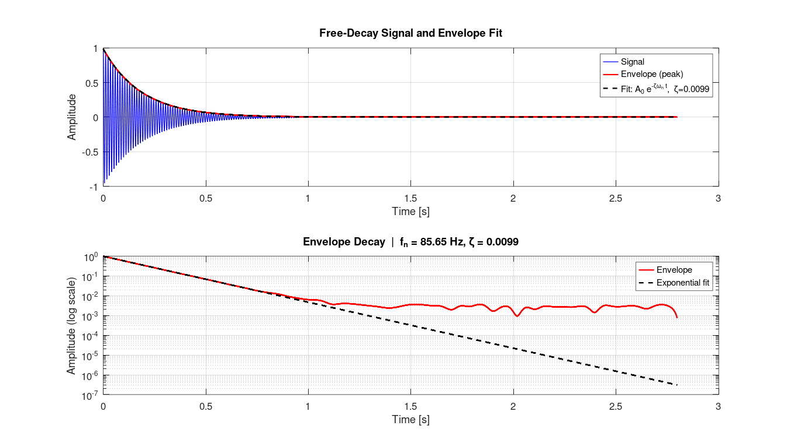

# Guitar Modal Analysis — Acoustic Measurements (MEAV)

> **Discipline Project** · Experimental Methods in Acoustics and Vibrations · UFSM · 2019

---

## Overview

Signal processing routines for experimental modal analysis of an acoustic guitar, focusing on **free-decay damping estimation** from IEPE accelerometer signals. Developed in the MEAV (Experimental Methods in Acoustics and Vibrations) discipline at UFSM.

The main contribution is the **logarithmic decrement** damping estimation pipeline, applied to identify structural damping in individual guitar body resonances.

---

## Damping Estimation Method

### Logarithmic Decrement

The damping ratio $\zeta$ is estimated from the decay envelope of a free-vibration signal:

$$\delta = \frac{1}{p} \ln\left(\frac{x_n}{x_{n+p}}\right)$$

$$\zeta = \frac{\delta}{\sqrt{4\pi^2 + \delta^2}} \approx \frac{\delta}{2\pi} \quad (\text{for small } \zeta)$$

### Pipeline

```
Free-decay signal → find_decay() (envelope extraction)
                 → local_peaks() (period estimation → wn)
                 → log. decrement → zeta
                 → exponential fit A*exp(-zeta*wn*t) for validation
```

---

## File Structure

```
03_guitar-modal-analysis/
│
├── acquisition/
│   └── data_acquisition.m          ← NI-DAQ acquisition for guitar measurements
│
├── processing/
│   └── damping_estimator.m         ← Full log-decrement pipeline
│
└── utils/
    ├── find_decay.m                 ← Signal delay removal + peak envelope
    └── local_peaks.m                ← Portable peak detection (min. distance / height / prominence)
```

---

## Key Functions

| Function | Description |
|----------|-------------|
| `find_decay(x, n)` | Removes signal delay; extracts upper decay envelope using peak spacing `n` |
| `damping_estimator.m` | Full pipeline: envelope → log. decrement → exponential fit |
| `data_acquisition.m` | Impact test: tri-axial acceleration + force, H1 FRF and coherence, saves signals for `damping_estimator.m` |

---

## Hardware

- NI cDAQ-9234 (IEPE, 4-channel, 24-bit)
- IEPE accelerometers (X, Y, Z axes)
- Impact hammer with IEPE force transducer
- Sampling rate: 51 200 Hz

---

## Dependencies

- No toolboxes required — runs in MATLAB and GNU Octave (`local_peaks.m` replaces `findpeaks`/`envelope`)

---


## Results


***Method validation on a synthetic free decay** (ζ = 1 %, fn = 85.6 Hz, with noise): the estimator recovers ζ = 0.0099 and fn = 85.65 Hz. Measured guitar data are not included in the repository.*

---

## References

- Ewins, D.J. (2000). *Modal Testing: Theory, Practice and Application*. Research Studies Press.
- Inman, D.J. (2014). *Engineering Vibration*. 4th ed. Pearson.
