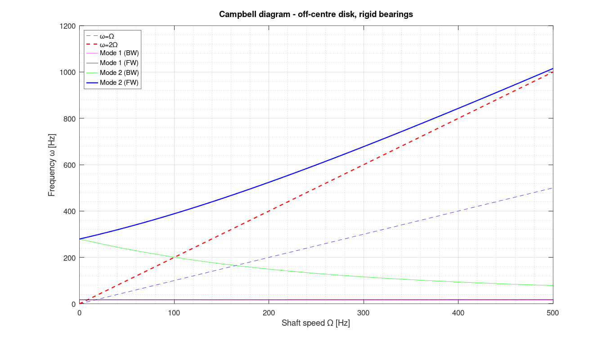
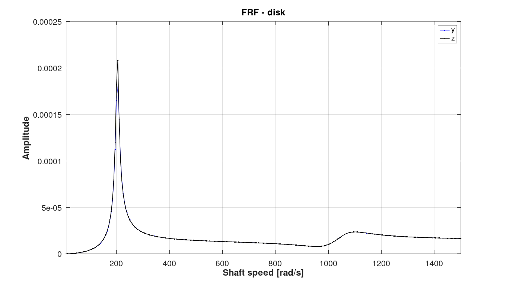
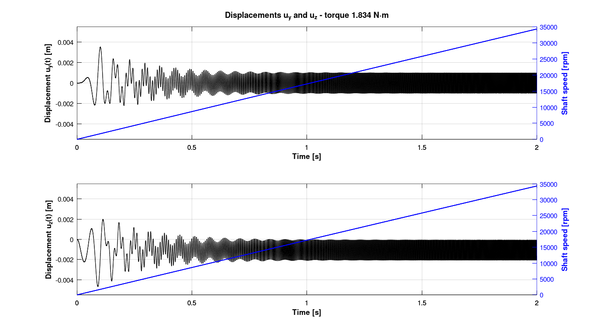
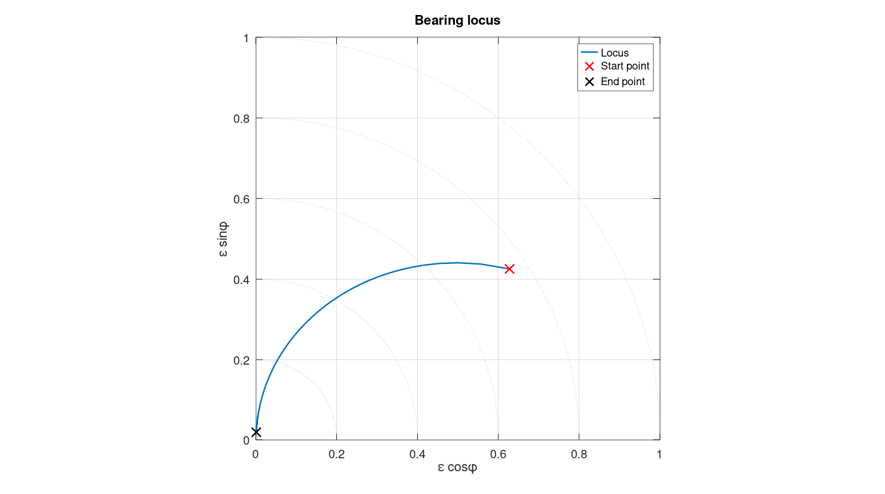
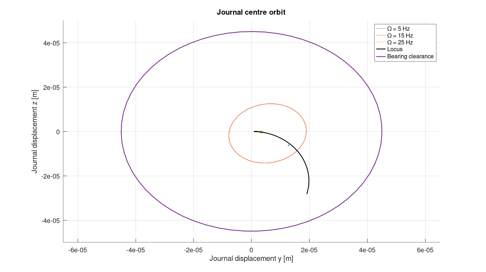

# 07 — Rotordynamics (Análise de Máquinas Rotativas)

Numerical simulation of rotating machinery dynamics, including shaft-disk systems with hydrodynamic bearings, unbalance response, and finite element shaft modeling.

## Files

| File | Description |
|---|---|
| `exe1.m` | **Exercise 1** – ODE45 simulation of shaft-disk system for 3 torque cases (EDT1/2/3). Plots displacement and rotational speed. |
| `EDT1.m` | Equations of motion – Case 1 (T = 1.834 N·m) |
| `EDT2.m` | Equations of motion – Case 2 (T = 0.0825 N·m) |
| `EDT3.m` | Equations of motion – Case 3 (T = 0.075 N·m) |
| `Exe2.m` | **Exercise 2** – Eccentric disk with rigid bearings. Computes stiffness, critical speed, whirl orbits and Campbell diagram. |
| `T3_v2.m` | **Exercise 3** – Modal analysis of 3-DOF rotor system. Frequency response functions and mode shapes. |
| `T4_v2.m` | **Exercise 4** – Hydrodynamic bearing model. Equilibrium eccentricity/attitude (Newton-Raphson), Sommerfeld number, dynamic stiffness/damping coefficients and unbalance orbits of disk and journal. |
| `AMR_T5_v6.m` | **Exercise 5** – FE shaft model (Euler-Bernoulli, gyroscopic) on hydrodynamic bearings with speed-dependent coefficients. Unbalance response vs. speed, deflected shapes, orbits and bearing locus. |
| `intrpElipse.m` | Utility: arc-length reparametrization of elliptic orbit for whirl-orbit plotting. |
| `MNR_bearing.m` | Newton-Raphson with analytic Jacobian — bearing equilibrium (eccentricity ε, attitude angle φ) for `T4_v2.m` / `AMR_T5_v6.m`. |
| `plot_disp_speed.m` | Dual-axis plot (displacement / speed) used by `exe1.m` (portable replacement for `yyaxis`). |
| `eqsp.m` | Modal-coordinate equations of motion integrated by `T3_v2.m`. |
| `eqsd_v1.m` | Rotor-on-hydrodynamic-bearing equations of motion (with kᵢⱼ, cᵢⱼ) integrated by `T4_v2.m`. |

## Topics Covered
- Shaft-disk equations of motion (gyroscopic effect, unbalance)
- Critical speed computation via stiffness matrix
- Hydrodynamic bearings (Sommerfeld number, short-bearing theory)
- Dynamic bearing coefficients (Kxx, Kxy, Cxx, Cxy)
- Finite element shaft model (Euler-Bernoulli beam elements with consistent mass and gyroscopic matrices)
- Campbell diagram (forward/backward whirl, `Exe2.m`)
- Unbalance response of the FE rotor-bearing model (`AMR_T5_v6.m`)

## Dependencies
- MATLAB ODE suite (`ode45`)
- Symbolic Math Toolbox only for `T3_v2.m` (Rayleigh damping fit)
- Image Processing Toolbox (`viscircles`, bearing-locus plot in `AMR_T5_v6.m`)

## Notes
- `EDT1/2/3.m` are state-space functions called by `exe1.m`; they must remain in the same folder.
- `T4_v2.m` and `AMR_T5_v6.m` save figures to `./output_figures/` when `savefig = 1` (folder created automatically, ignored by git).
- Progress is shown with MATLAB's built-in `waitbar`.

---
## Results

*Campbell diagram of the overhung-disk rotor on rigid bearings: forward/backward whirl split by the gyroscopic effect — `Exe2.m`.*

*FE rotor on hydrodynamic bearings: deflected shape and whirl orbits along the shaft near the first critical speed — `AMR_T5_v6.m`.*

*Unbalance response of the disk vs. rotational speed (FE model with speed-dependent bearing coefficients) — `AMR_T5_v6.m`.*

*Run-up through the critical speed under constant torque (shaft-disk ODE model) — `exe1.m`.*

*Short hydrodynamic bearing: equilibrium locus of the journal centre (ε, φ) from low to high speed — `T4_v2.m` with `MNR_bearing.m`.*

*Journal orbits at 5, 15 and 25 Hz inside the bearing clearance, with the equilibrium locus — `T4_v2.m`.*
