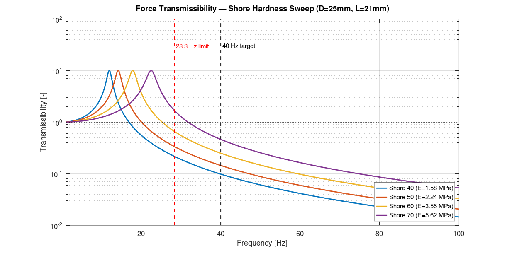
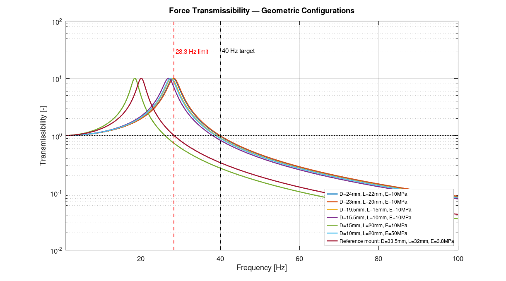

# Engine Mount Parameter Estimation — Rubber Isolator (Coxim)

> **Academic Estimation Study** · UFSM · 2018

---

## Overview

MATLAB routines for estimating stiffness parameters of cylindrical rubber engine mounts, targeting vibration isolation of a **40 Hz excitation source** (e.g., engine firing frequency).

The design goal is to find geometric configurations (diameter D, length L, Young's modulus E) such that the mount resonance frequency $f_r$ falls below $40/\sqrt{2} \approx 28.3$ Hz, ensuring at least −3 dB attenuation at the design frequency.

---

## Physical Model

### Single Mount Stiffness (Complex — Includes Damping)

$$K_i = \frac{E(1 + j\eta) \cdot A}{L}, \quad A = \frac{\pi D^2}{4}$$

### Total System Stiffness (4 mounts in parallel)

$$K_{total} = 4 \cdot K_i$$

### Force Transmissibility

$$T(\omega) = \left|\frac{K_{total}}{K_{total} - M\omega^2}\right|$$

### Design Criterion

$$f_r = \frac{1}{2\pi}\sqrt{\frac{K_{total}}{M}} < \frac{f_{target}}{\sqrt{2}} \approx 28.3 \text{ Hz}$$

---

## Shore A → Young's Modulus

| Shore A | E (approx.) |
|---------|-------------|
| 40 | 1.58 MPa |
| 50 | 2.24 MPa |
| 60 | 3.55 MPa |
| 70 | 5.62 MPa |

---

## Files

| File | Description |
|------|-------------|
| `engine_mount_analysis.m` | Main script — two parametric sweeps + transmissibility plots |
| `compute_transmissibility.m` | Transmissibility and resonance frequency of 4 mounts (used by the main script) |

---

## Usage

```matlab
run engine_mount_analysis.m
```

Two parametric studies are computed:
1. **Geometric sweep** — 7 configurations with different D, L, E
2. **Shore hardness sweep** — 4 rubber grades (Shore 40/50/60/70) with fixed geometry

---

## Key Outputs

- Transmissibility curve T(f) for each configuration
- Resonance frequency $f_r$ printed for each case
- Visual comparison against the 28.3 Hz design limit

---

## Note on Data

Geometric and material parameters are academic estimates for a motor vibration isolation study. Supplier, product and material trade names are intentionally omitted; the last geometric configuration is referred to only as a *reference mount*.

---


## Results


*Force transmissibility for Shore 40–70 rubber (D = 25 mm, L = 21 mm) against the 28.3 Hz design limit and the 40 Hz excitation.*


*Force transmissibility for the candidate mount geometries.*

---

## References

- Harris, C.M. & Piersol, A.G. (2002). *Harris' Shock and Vibration Handbook*. 5th ed. McGraw-Hill.
- Snowdon, J.C. (1968). *Vibration and Shock in Damped Mechanical Systems*. Wiley.
