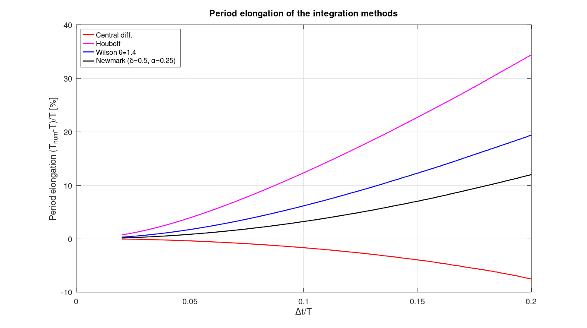
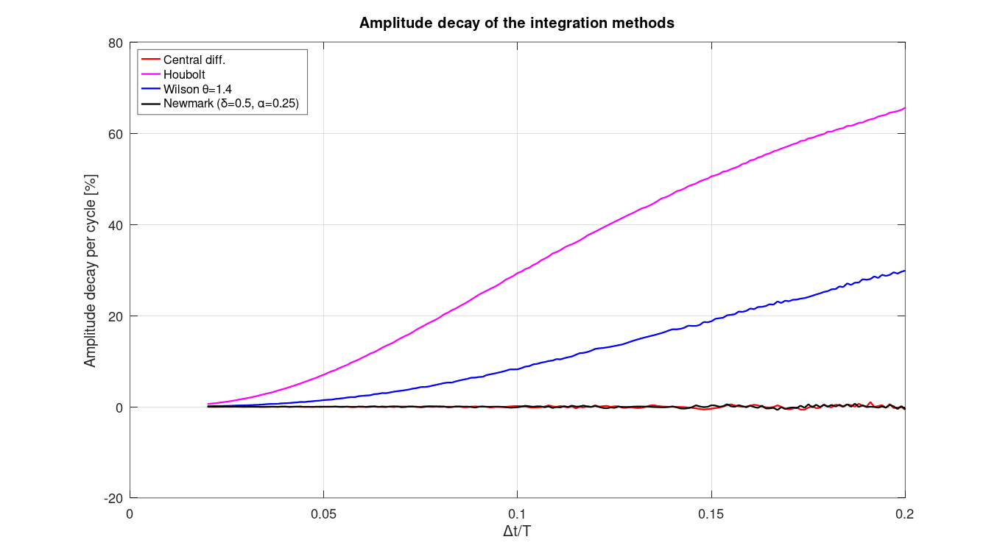
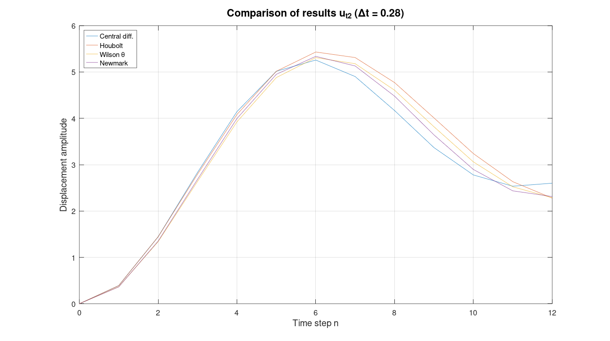

# 08 — FEM Time Integration Methods (Elementos Finitos 3)

Implementation and stability analysis of direct time-integration methods for structural dynamics, including central differences, Houbolt, Newmark, and Wilson-θ. Also includes FEM formulation for triangular elements and truss buckling.

## Files

### Integration Method Functions

| File | Method | Notes |
|---|---|---|
| `MDC1.m` | Central Differences v1 | Returns displacement vector |
| `MDC2.m` | Central Differences v2 | Returns u, u̇, ü |
| `MH3.m` | Houbolt | Implicit multistep method; started by central differences (`MDC2`). Applied to the 2-DOF benchmark of Bathe's Example 9.1. |
| `MNK1.m` | Newmark v1 | Configurable δ and α parameters |
| `MWT1.m` | Wilson-θ v1 | Configurable θ |

### Analysis Scripts

| File | Description |
|---|---|
| `EF3T4.m` | **Work 4** – Wilson-θ applied to 2-DOF system (M, K, C matrices) |
| `EF3T5.m` | **Work 5** – Newmark applied to same 2-DOF benchmark system |
| `EF3T7.m` | **Work 7** – Central differences applied to the same system |
| `EstabilidadeMetodos.m` | Stability analysis comparing all methods via spectral radius |
| `EstabilidadeMatrizA.m` | Stability via amplification matrix A eigenvalue sweep over θ |
| `precisao_Finalv6.m` | Period elongation and amplitude decay per cycle vs. Δt/T (measured from zero crossings and peaks of the free response) |
| `MainTrelic.m` | Truss buckling load – geometric stiffness matrix approach |
| `mainItinv.m` | Natural frequencies/modes of a 4-DOF system by inverse iteration with Gram-Schmidt deflation, validated against `eig` |
| `T1_F.m` | Linear triangular element – symbolic K and consistent/lumped (HRZ) mass matrices |
| `T2.m` | Work 2 – Central differences, raw implementation |

### Utilities

| File | Description |
|---|---|
| `caso1.m` | Truss geometry: equilateral triangle configuration |
| `caso2.m` | Truss geometry: right-angle triangle configuration |
| `itinv.m` | Inverse power iteration for K·φ = λ·M·φ, with optional deflation of previously found modes |

## Topics Covered
- Explicit methods: central differences (conditional stability, Δtcrit = Tcrit/π)
- Implicit methods: Houbolt, Newmark (unconditionally stable for δ≥0.5, α≥0.25(0.5+δ)²), Wilson-θ
- Stability analysis: spectral radius ρ(A) ≤ 1 criterion
- Period elongation and amplitude decay as function of Δt/T
- FEM triangular plane-stress element (shape functions, K, M)
- Truss geometric stiffness and buckling load
- Generalized eigenproblem by inverse iteration (M-orthogonal deflation)

## Usage Example

```matlab
% Solve a 2-DOF system with Newmark
M = [2 0; 0 1];
K = [6 -2; -2 4];
C = zeros(2);
R = [0; 10];
u0 = [0;0]; u0p = [0;0]; u0pp = M\(R - K*u0);
dt = 0.1; Np = 100; delt = 0.5; alp = 0.25;
[u, up, upp] = MNK1(M, K, C, R, u0, u0p, u0pp, dt, Np, delt, alp);
```

## Notes
- `T1_F.m` requires the Symbolic Math Toolbox.
- `precisao_Finalv6.m` simulates 20 free-vibration periods for each of 181 Δt values (≈ 15 s in GNU Octave).

---
## Results


*Spectral radius of the amplification matrix vs Δt/T for central differences, Houbolt, Wilson-θ and Newmark — `EstabilidadeMatrizA.m`.*


*Period elongation (T_num − T)/T vs Δt/T: central differences shortens the period, the implicit methods lengthen it — `precisao_Finalv6.m`.*


*Amplitude decay per cycle: Newmark (average acceleration) and central differences conserve energy; Houbolt and Wilson-θ add numerical damping — `precisao_Finalv6.m`.*


*2-DOF benchmark (Bathe, Example 9.1) solved with the four integrators, Δt = 0.28 s — `EstabilidadeMetodos.m`.*
