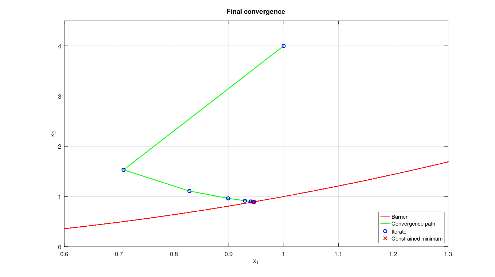
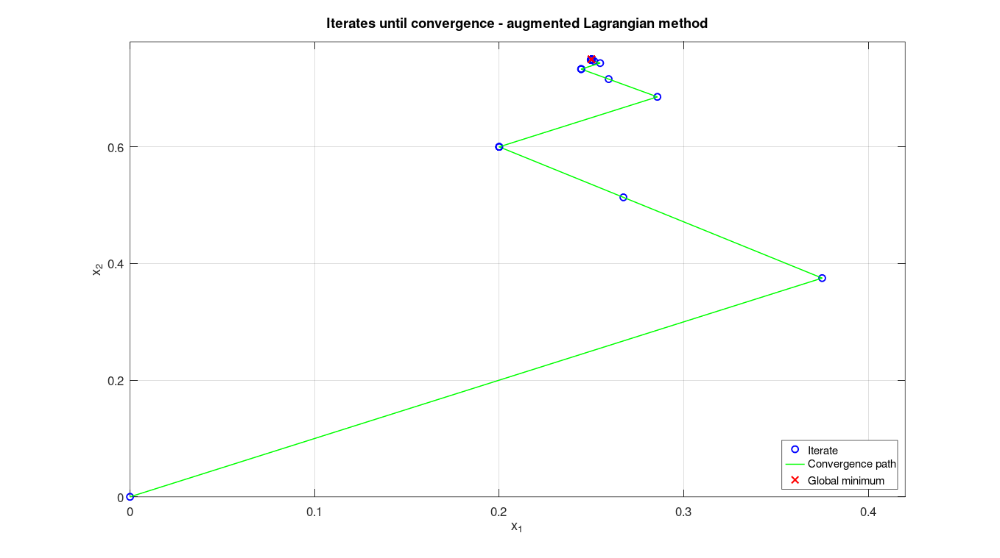

# Optimization Methods (Métodos de Otimização de Sistemas)

Modular library of unconstrained and constrained optimization methods implemented in MATLAB, developed for the graduate course *Métodos de Otimização de Sistemas* at UNICAMP.

## File Structure

### Unidimensional Search Methods

| File | Method |
|---|---|
| `MDicotomica2.m` | Dichotomous search (bisection by function value) |
| `MDicotomicaDeriv.m` | Dichotomous search (bisection by derivative sign) |
| `MDicoF.m` | Dichotomous search – multivariable line search version |
| `MDicoP.m` | Dichotomous search – augmented Lagrangian variant |
| `MDicoPen.m` | Dichotomous search on a penalized function φ(x, c) (penalty and barrier) |
| `MFibo.m` | Fibonacci search |
| `MNewton.m` | Newton's method (1D, uses symbolic differentiation) |

### Multivariable Unconstrained Methods

| File | Method |
|---|---|
| `MGradDicoF.m` | Gradient descent with dichotomous line search |
| `MQsNewtDico.m` | Quasi-Newton DFP with dichotomous line search |
| `MQsNewtDicoB.m` | Quasi-Newton DFP – barrier method variant |
| `MQsNewtDicoP.m` | Quasi-Newton DFP – augmented Lagrangian subproblem |
| `MQsNewtDicoPen.m` | Quasi-Newton DFP – penalty subproblem |
| `MNewtDicoF.m` | Newton's method with dichotomous line search |

### Constrained Optimization Methods

| File | Method |
|---|---|
| `MPenalidade.m` | Exterior penalty method |
| `MBarreira.m` | Interior barrier method |
| `MLGAum.m` | Augmented Lagrangian method |
| `MSimplex.m` | Simplex (revised) – Problem 1 |
| `MSimplexP2.m` | Simplex (revised) – Problem 2 (transportation problem) |

### Main Scripts (Examples)

| File | Description |
|---|---|
| `Lista1Exe1.m` | 1D search: dichotomous, Fibonacci, Newton on f(x)=x²+2x |
| `Main_lista2.m` | Gradient and quasi-Newton methods on 4 test functions |
| `Main_lista3.m` | Secant + Quasi-Newton (DFP) comparison |
| `Main_MPenalidade.m` | Penalty method on constrained 2D problem |
| `Main_MBarreira.m` | Barrier method on constrained 2D problem |
| `Main_MLGA.m` | Augmented Lagrangian on equality-constrained problem |

### Test Functions

| File | Function |
|---|---|
| `func1.m` | f(x) = (x₁-1)⁴ + (x₁-x₂)² — Rosenbrock-like |
| `func2.m` | Quadratic bowl |
| `func3.m` | Another test function |
| `func4.m` | Another test function |
| `cfeqLGA.m` | Constraint function for Lagrangian test |
| `confuneqBarreira.m` | Constraint function for barrier test |

## Topics Covered
- Unidimensional search: dichotomous, Fibonacci, Newton
- Gradient methods: steepest descent, quasi-Newton (DFP update)
- Constrained optimization: penalty, barrier, augmented Lagrangian
- Linear programming: revised Simplex method

## Usage Example

```matlab
% Minimize f(x1,x2) = (x1-2)^4 + (x1-2*x2)^2
% subject to: x1^2 - x2 >= 0  (inequality constraint)

fx  = @(x) (x(1)-2)^4 + (x(1)-2*x(2))^2;
g   = @(x) [4*(x(1)-2)^3 + 2*(x(1)-2*x(2)); -4*(x(1)-2*x(2))];
B   = @(x) 1/(x(1)^2 - x(2));
dB  = @(x) [-(2*x(1))/(x(1)^2-x(2))^2; 1/(x(1)^2-x(2))^2];

x0 = [1; 4]; ci = 10; gamma = 10; errp = 1e-10;
[xi, xrvec, i, ~, ~] = MBarreira(fx, g, B, dB, x0, ci, gamma, -10, 10, 500, errp, 1000, 0);
fprintf('Optimal x = [%.4f; %.4f] in %d iterations\n', xi(1), xi(2), i);
```

## Notes
- `MNewton.m`, `MDicotomica2.m`, `MDicotomicaDeriv.m` use the Symbolic Math Toolbox (`diff`, `subs`).
- All other methods are purely numerical and require no extra toolboxes.
- `MSimplex.m` and `MSimplexP2.m` are self-contained scripts (not functions) for specific list problems.

---
## Results


*Quasi-Newton DFP with dichotomous line search on a Rosenbrock-type function, from (−1.2, 1) to the optimum (1, 1) — `MQsNewtDico.m`.*


*Interior barrier method: iterates stay feasible and approach the constraint x₂ = x₁² — `Main_MBarreira.m`.*


*Augmented Lagrangian on an equality-constrained quadratic, converging to (0.25, 0.75) — `Main_MLGA.m`.*
