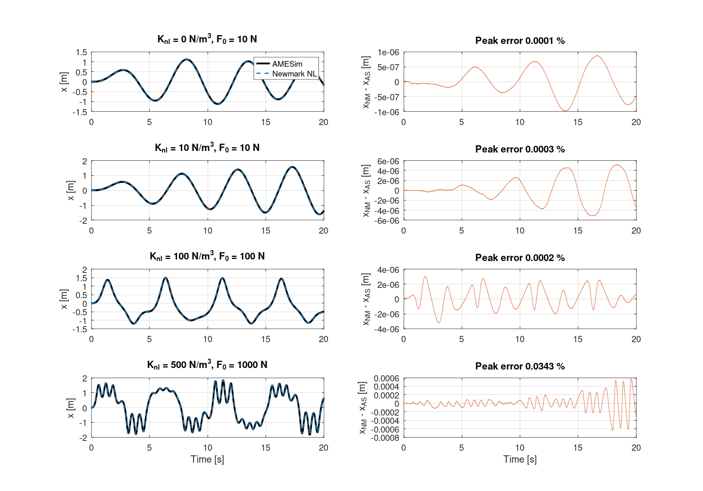
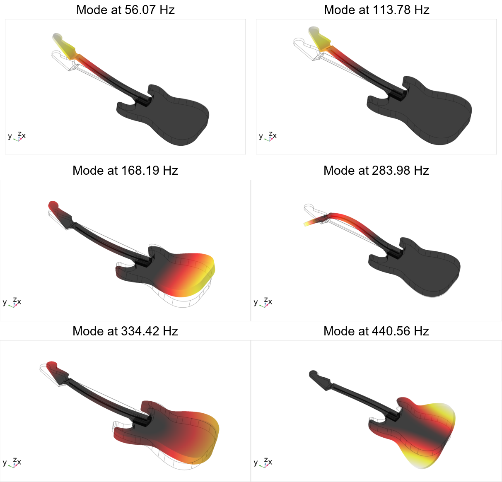
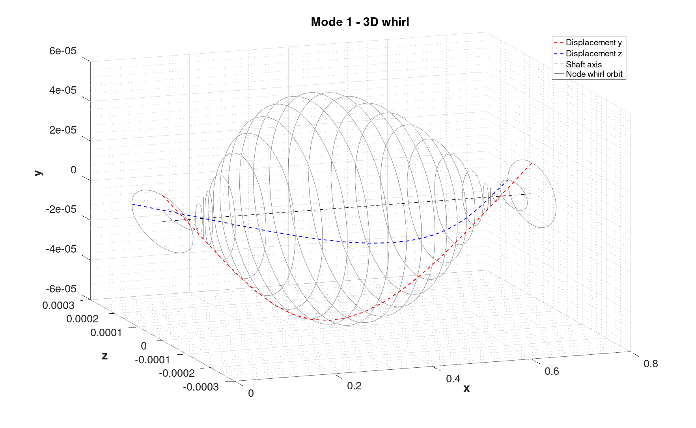
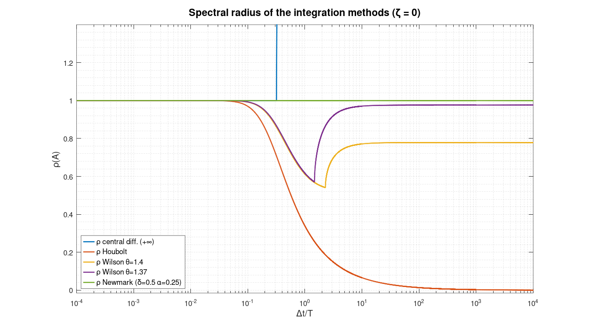
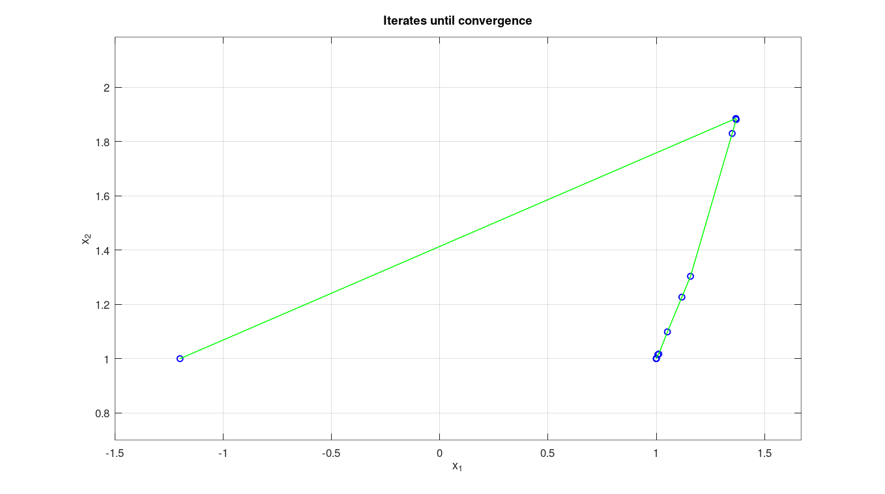

# MATLAB Engineering Portfolio — Nicolás Londero Gass


**MSc in Mechanical Engineering — UNICAMP (2025)**  
**BSc in Acoustical Engineering — UFSM (2020)**

---

## About

This repository contains MATLAB routines developed during my BSc in Acoustical Engineering (UFSM) and my MSc in Mechanical Engineering (UNICAMP). The projects cover nonlinear structural dynamics, experimental modal analysis, damping identification, rotordynamics, vibration isolation, FEM time integration and numerical optimization.

All routines are documented with function descriptions, physical equations and references, and each project README shows result figures produced by the code itself. The numerical routines were checked against analytical solutions, textbook benchmarks and commercial software (Simcenter AMESim), and run in both MATLAB and GNU Octave.

---

## Projects

| Folder | Topic | Keywords | Level |
|--------|-------|----------|-------|
| [`01_nonlinear-newmark-method`](01_nonlinear-newmark-method/) | Nonlinear structural dynamics | Newmark, Newton-Raphson, impact pair, gear clunk, NVH | MSc |
| [`02_modal-analysis-tcc`](02_modal-analysis-tcc/) | Experimental modal analysis | FRF, H1, CMIF, MAC, impact hammer, shaker, NI-DAQ | BSc thesis |
| [`03_guitar-modal-analysis`](03_guitar-modal-analysis/) | Structural dynamics | Free decay, log. decrement, damping estimation | BSc |
| [`04_rotordynamics`](04_rotordynamics/) | Rotating machinery | Shaft-disk, whirl orbits, hydrodynamic bearings, Campbell diagram, FE shaft | MSc |
| [`05_engine-mount-parameter-estimation`](05_engine-mount-parameter-estimation/) | Vibration isolation | Rubber mount, transmissibility, Shore hardness | BSc |
| [`06_fem-time-integration`](06_fem-time-integration/) | FEM time integration | Newmark, Houbolt, Wilson-θ, central differences, stability, period elongation | MSc |
| [`07_optimization-methods`](07_optimization-methods/) | Numerical optimization | Quasi-Newton DFP, augmented Lagrangian, penalty, barrier, Simplex, gradient | MSc |

---

## Highlighted Projects

### 🏆 Nonlinear Newmark Method (`01_nonlinear-newmark-method`)

Implementation of the nonlinear predictor-corrector Newmark scheme with Newton-Raphson iterations for systems with cubic stiffness nonlinearity. Developed and validated against Simcenter AMESim for the MSc dissertation:

> **Gass, N.L. (2025).** *Nonlinear Modeling of Clunk Noise in Vehicle Transmission Systems.* MSc Dissertation, UNICAMP.

- Dissertation (impact-pair model, $\Delta t = 0.001$ s): mean displacement error **0.107 %**, acceleration error **1.51 %**.
- Reproducible benchmark in [`validation/`](01_nonlinear-newmark-method/validation/) (cubic spring, harmonic load): peak displacement error **≤ 0.034 %**.



---

### 🎸 Experimental Modal Analysis of an Electric Guitar (`02_modal-analysis-tcc`)

BSc thesis: impact-hammer and shaker testing of an electric guitar with NI-DAQ acquisition, H1 FRFs on a 10 × 10 matrix, CMIF, modal parameter extraction and MAC, compared with a finite element model of the instrument.

> **Gass, N.L. (2020).** *Análise modal e caracterização de guitarras elétricas.* BSc thesis, Acoustical Engineering, UFSM.



---

### ⚙️ Rotordynamics (`04_rotordynamics`)

Five-exercise series covering the full analytical pipeline of rotating machinery: from ODE-based shaft-disk simulations to a complete finite element shaft model with hydrodynamic bearing coefficients. Produces Campbell diagrams, whirl orbits, bearing equilibrium loci and unbalance response curves.



---

### 📐 FEM Time Integration (`06_fem-time-integration`)

Library of direct time-integration solvers (Central Differences, Houbolt, Newmark, Wilson-θ) implemented as reusable MATLAB functions with a consistent interface. Includes algorithmic stability analysis via spectral radius and amplification matrix, plus period elongation and amplitude decay curves as a function of Δt/T.



---

### 🔢 Optimization Methods (`07_optimization-methods`)

Modular library of unconstrained and constrained optimization algorithms: unidimensional search (Fibonacci, dichotomous, Newton), multivariable gradient and quasi-Newton (DFP), and constrained methods (penalty, barrier, augmented Lagrangian, Simplex). All methods are standalone functions with documented inputs/outputs and `Main_` driver scripts.



---

## Repository Structure

```
matlab-engineering-portfolio/
│
├── README.md
├── LICENSE
├── .gitignore
│
├── 01_nonlinear-newmark-method/
│   ├── README.md
│   ├── core/          ← Solvers (Newmark NL, Newmark Linear, RK4)
│   ├── models/        ← System parameters, force generators, state-space
│   ├── examples/      ← Self-contained runnable example
│   ├── validation/    ← Reproducible comparison against Simcenter AMESim
│   └── figures/       ← Result figures shown in the README (one folder per project)
│
├── 02_modal-analysis-tcc/
│   ├── README.md
│   ├── acquisition/   ← NI-DAQ real-time measurement scripts
│   ├── processing/    ← CMIF, modal estimator, mode animation
│   └── utils/         ← FRF plotter, peak detection, excitation generator
│
├── 03_guitar-modal-analysis/
│   ├── README.md
│   ├── acquisition/
│   ├── processing/    ← Logarithmic decrement damping estimator
│   └── utils/         ← Decay envelope extraction, portable peak detection
│
├── 04_rotordynamics/
│   ├── README.md
│   ├── exe1.m              ← Shaft-disk ODE45 simulation (3 torque cases)
│   ├── EDT1/2/3.m          ← Equations of motion (state-space functions)
│   ├── Exe2.m              ← Eccentric disk, rigid bearings, critical speed
│   ├── T3_v2.m             ← Modal analysis 3-DOF rotor, FRF
│   ├── T4_v2.m             ← Hydrodynamic bearings, Sommerfeld, dyn. coefficients
│   ├── AMR_T5_v6.m         ← FE shaft on hydrodynamic bearings, unbalance response
│   ├── MNR_bearing.m       ← Newton-Raphson (bearing equilibrium ε, φ)
│   ├── eqsp.m / eqsd_v1.m  ← Equations of motion for ode45
│   └── intrpElipse.m       ← Whirl orbit arc-length reparametrization (utility)
│
├── 05_engine-mount-parameter-estimation/
│   ├── README.md
│   ├── engine_mount_analysis.m
│   └── compute_transmissibility.m
│
├── 06_fem-time-integration/
│   ├── README.md
│   ├── MDC1.m / MDC2.m     ← Central differences v1 and v2
│   ├── MH3.m               ← Houbolt method
│   ├── MNK1.m              ← Newmark (configurable δ, α)
│   ├── MWT1.m              ← Wilson-θ (configurable θ)
│   ├── EstabilidadeMetodos.m   ← Spectral radius comparison
│   ├── EstabilidadeMatrizA.m   ← Amplification matrix eigenvalue sweep
│   ├── precisao_Finalv6.m      ← Period elongation vs. Δt/T
│   ├── MainTrelic.m            ← Truss buckling (geometric stiffness)
│   ├── itinv.m / mainItinv.m   ← Inverse iteration eigen-solver with deflation
│   └── T1_F.m                 ← Triangular FE element formulation
│
└── 07_optimization-methods/
    ├── README.md
    ├── MDicotomica2.m / MDicoF.m   ← Dichotomous search variants
    ├── MFibo.m                     ← Fibonacci search
    ├── MNewton.m                   ← Newton's 1D method
    ├── MGradDicoF.m                ← Gradient descent + line search
    ├── MQsNewtDico.m               ← Quasi-Newton DFP
    ├── MPenalidade.m               ← Exterior penalty
    ├── MBarreira.m                 ← Interior barrier
    ├── MLGAum.m                    ← Augmented Lagrangian
    ├── MSimplex.m / MSimplexP2.m   ← Revised Simplex
    ├── Main_lista2/3.m             ← Driver scripts (unconstrained)
    ├── Main_MPenalidade.m / Main_MBarreira.m / Main_MLGA.m ← Driver scripts (constrained)
    └── func1–4.m                   ← Test objective functions
```

---

## Running in MATLAB or GNU Octave

The code targets **MATLAB R2019b+** and was also run end-to-end in **GNU Octave 11.3**. MATLAB-only plot calls have portable fallbacks (`plotyy` instead of `yyaxis`, plain lines instead of `xline`/`yline`, `imagesc` when `bar3` is missing, `sgtitle`/`datatip` only when available).

**How to run a script:** the `matlab` code blocks in the project READMEs are typed in the **MATLAB or Octave Command Window** (not in a system terminal). Set the current folder to the script's folder and run it, e.g.

```matlab
cd 01_nonlinear-newmark-method/examples
run main_impact_pair.m
```

From a system terminal, GNU Octave can run a script directly (figures stay open until you press Enter):

```bash
octave --eval "run('main_impact_pair.m'); input('Press Enter to close');"
```

| In Octave you need | For |
|---|---|
| `pkg load symbolic` (+ Python with SymPy) | `04/T3_v2.m`, `06/T1_F.m`, `07/Lista1Exe1.m` — loaded automatically by the scripts |
| `pkg load control` | `01/models/state_space_model.m` (`lsim`) — loaded automatically |
| MATLAB only | NI-DAQ acquisition scripts (`02/acquisition`, `03/acquisition`) and the `modalsd` stabilization diagram in `02` (skipped in Octave) |

---

## Tools and Methods

| Category | Tools |
|----------|-------|
| Programming | MATLAB R2019b+ · GNU Octave 11 |
| Data acquisition | NI-DAQmx, NI cDAQ-9234, IEPE sensors |
| Numerical methods | Newmark (linear/nonlinear), RK4, Central Differences, Houbolt, Wilson-θ |
| Optimization | Gradient descent, Quasi-Newton (DFP), Penalty, Barrier, Augmented Lagrangian, Simplex |
| Signal processing | H1 FRF estimator, coherence, Welch, CMIF/SVD |
| Rotordynamics | Shaft-disk ODE, FE shaft model, hydrodynamic bearing theory, Campbell diagram |
| Validation | Simcenter AMESim (Project 01), MATLAB `lsim` / `ode45` |

---

## Contact

- 📧 nicolas.gass@eac.ufsm.br
- 🔗 [LinkedIn](https://www.linkedin.com/in/n%C3%ADcolas-londero-gass-a664a7177/)

---

*All code written for academic purposes. Supplier and product names are omitted where applicable.*

*Third-party helpers (`MAC.m`, `pickpeaks.m`, `oscillator.m`, `animate_mode.m` in project 02) are credited to their original authors in the file headers and in the project README.*
